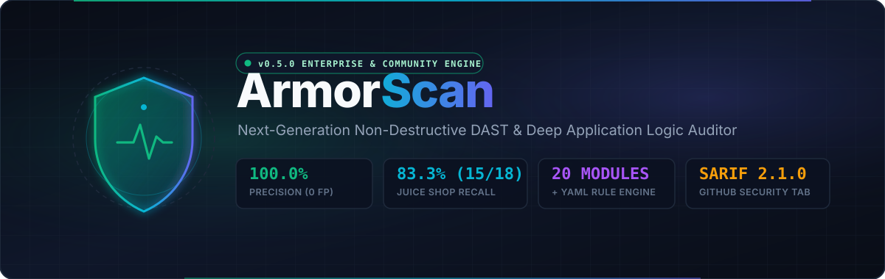
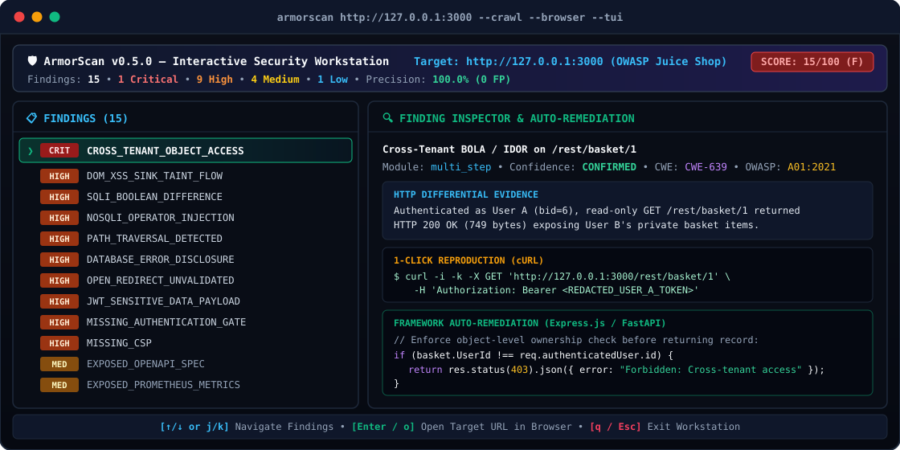
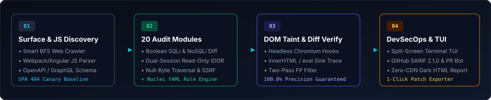
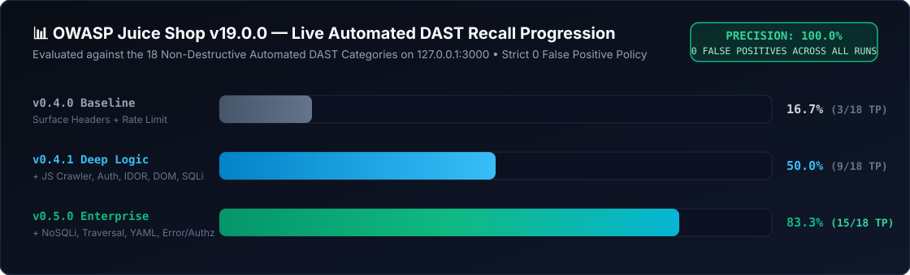

<div align="center">

  <a href="https://github.com/AmhetCnaa/ArmorScan">
    
  </a>

  <br />
  <br />

  <p align="center">
    <em>"The Sovereign Engine: Next-generation, non-destructive DAST, Self-Healing Auto-PRs, Multi-Role BOLA Matrices, Live Proxy Auditing, and Autonomous DevSecOps Sentinel — with 0 False Positives."</em>
  </p>

  <p align="center">
    <a href="pyproject.toml"></a>
    <a href="https://github.com/AmhetCnaa/ArmorScan/releases/tag/v0.7.0"></a>
    <a href="benchmark/juice_shop_results.md"></a>
    <a href="benchmark/juice_shop_results.md"></a>
    <a href="armorscan/templates/"></a>
    <a href="tests/"></a>
    <a href="LICENSE"></a>
    <a href="https://github.com/AmhetCnaa/ArmorScan/actions/workflows/ci.yml"></a>
  </p>

  <p align="center">
    <a href="#-start-in-30-seconds"><strong>Quick Start</strong></a> &nbsp;•&nbsp;
    <a href="#-multi-role-bolaidor-permission-matrix"><strong>BOLA Matrix</strong></a> &nbsp;•&nbsp;
    <a href="#-built-in-http-forward-proxy--live-traffic-auditor"><strong>Live Proxy</strong></a> &nbsp;•&nbsp;
    <a href="#-self-healing-ai--automated-github-pull-request-opener"><strong>Auto-PR</strong></a> &nbsp;•&nbsp;
    <a href="#-api-fuzzing--anomaly-crash-detector"><strong>API Fuzzing</strong></a> &nbsp;•&nbsp;
    <a href="#-autonomous-sentinel--continuous-security-watcher"><strong>Sentinel</strong></a> &nbsp;•&nbsp;
    <a href="#-scientific-benchmark-owasp-juice-shop"><strong>Juice Shop Benchmark</strong></a>
  </p>

</div>

---

## ⚡ Start in 30 Seconds

```bash
# 1. Install (via pip or pipx)
pip install armorscan

# 2. Interactive Terminal Workstation (TUI) or Full HTML Topology Report
armorscan http://localhost:3000 --tui
armorscan http://localhost:3000 --html report.html

# 3. Multi-Role BOLA/IDOR Permission Matrix & Non-Destructive API Fuzzing
armorscan http://localhost:3000 --matrix-roles "admin:Bearer <T1>,user:Bearer <T2>,guest:" --fuzz

# 4. Live Background HTTP Forward Proxy & Passive Traffic Auditor
armorscan proxy --port 8080 --auto-audit

# 5. Self-Healing AI: Automated Remediation Pull Request to GitHub
armorscan https://my-app.com --auto-pr --github-repo "owner/repo" --github-token "$GH_TOKEN"

# 6. CI/CD Quality Gate with GitHub SARIF 2.1.0 Code Scanning
armorscan https://staging.example.com --fail-under 80 --sarif results.sarif
```

---

## 🔐 Multi-Role BOLA/IDOR Permission Matrix

Broken Object Level Authorization (BOLA/IDOR) is the most critical vulnerability in modern API architectures. ArmorScan now automatically derives and verifies a **Role Access Control Matrix** across multi-tier identities using non-destructive, read-only differential probes:

```bash
armorscan http://localhost:3000 \
  --matrix-roles "admin:Bearer <T1>,user:Bearer <T2>,guest:"
```

- 🚨 **Unauthenticated BOLA (`CRITICAL`):** Flags when private user objects or orders return `200 OK` with sensitive records to unauthenticated guest visitors.
- ⚠️ **Cross-Tenant IDOR (`HIGH`):** Flags when Tenant B's credentials can retrieve Tenant A's private records without authorization checks.
- 📊 **Visual Access Matrix Grid:** Generates a real-time role permission table directly in the standalone HTML report (`armorscan-report.html`).

---

## 🛰️ Built-in HTTP Forward Proxy & Live Traffic Auditor

Route your browser, Cypress/Playwright suites, or mobile simulator traffic through ArmorScan to passively audit real-world traffic on the fly:

```bash
armorscan proxy --port 8080 --auto-audit
```

```text
[GET 200] /api/user/profile -> 🛡️ 3 Findings: MISSING_CSP, COOKIE_MISSING_HTTPONLY, AWS_KEY_LEAK
[GET 200] /static/main.js -> Clean
```

- ⚡ **Pure Asyncio Engine:** Zero external dependencies (no Java, no Mitmproxy required).
- 🔒 **HTTPS Tunneling:** Supports full TLS tunneling via standard HTTP `CONNECT`.
- 👁️ **Live Passive Audits:** Automatically inspects new routes for missing CSP, HSTS, insecure cookies without `HttpOnly`/`Secure`, leaked API keys (OpenAI, AWS, JWTs), and database stack traces.

---

## 🚀 "Self-Healing AI" — Automated GitHub Pull Request Opener

Close the remediation loop entirely. Instead of leaving developers with a diff to manually copy-paste, ArmorScan can automatically branch your repository, commit the patch, and open a ready-to-merge Pull Request:

```bash
armorscan https://my-app.com \
  --auto-pr \
  --github-repo "owner/repo" \
  --github-token "$GH_TOKEN"
```

1. **Synthesizes Patch:** Derives verified framework remediation for Express, FastAPI, Django, or Nginx.
2. **Creates Branch:** Spawns `armorscan/security-patch-<timestamp>` from the default branch.
3. **Commits Changes:** Updates the affected configuration or middleware file with a standardized commit message.
4. **Opens Pull Request:** Submits a rich Markdown PR detailing the CWE, severity, business impact, and verification instructions.

---

## 💥 API Fuzzing & Anomaly Crash Detector

Safely mutate parameter boundaries without sending destructive exploits or corrupting database records:

```bash
armorscan http://localhost:3000 --fuzz
```

- 🔢 **Numeric Extremes:** Tests 64-bit bounds (`9223372036854775807`, `-9223372036854775808`), `NaN`, `-1`, and floating-point epsilons.
- 🔤 **String & Buffer Bounds:** Probes with 1024-4096 character buffers, Unicode Right-to-Left (RTL) override (`\u202E`), and null-byte sequences (`%00`).
- 🧩 **JSON Type Confusion:** Mutates primitive fields into objects (`{}`), arrays (`[]`), and `null`.
- 🛡️ **Zero False Positive Anomaly Criteria:**
  - `UNHANDLED_EXCEPTION_500_ANOMALY` (**HIGH**): Server crashes with HTTP 500/502/503 when baseline was healthy.
  - `POTENTIAL_RESOURCE_EXHAUSTION_LAG` (**MEDIUM**): Latency degrades by >10x baseline (> 2.0s).

---

## 🛡️ Autonomous Sentinel — Continuous Security Watcher

Transform ArmorScan into a lightweight, zero-AI, 100% deterministic background security guardian. Sentinel runs continuous scans at fixed intervals, computes state differences against your baseline, and dispatches rich alert webhooks to **Discord**, **Slack**, or **Telegram** **ONLY** when a new vulnerability emerges or the security score drops:

```bash
# Monitor localhost every 1 hour and alert Discord & Slack on regressions
armorscan watch http://localhost:3000 \
  --interval 1h \
  --baseline armorscan-baseline.json \
  --webhook "https://discord.com/api/webhooks/..." \
  --slack-webhook "https://hooks.slack.com/services/..."

# Monitor production with Telegram alerts
armorscan watch https://api.example.com \
  --interval 24h \
  --telegram-token "123456:ABC-DEF..." \
  --telegram-chat "-100123456789"
```

- 🪶 **Ultra-Lightweight:** Consumes < 25 MB RAM and 0% CPU while sleeping.
- 🎯 **Zero Spam Tolerance:** Silent when the security posture is unchanged; alerts immediately on new flaws.
- 📈 **Score Regression Alerts:** Fires high-priority alerts if score decreases (e.g., `85 -> 60`).

---

## 🤖 AI Vulnerability Storyteller & Auto-Patch Engine

Stop handing developers raw stack traces without context. ArmorScan's dual-mode AI engine translates findings into executive business summaries and ready-to-apply unified git diffs:

```bash
armorscan http://localhost:3000 --ai-explain --ai-patch --repo-path ./my-app
```

- **Dual-Layer Architecture:**
  1. **Offline / Rule-Based (Default):** Zero API keys or external services required. Deterministically generates hardened patches for **Express.js**, **FastAPI**, **Django**, and **Nginx**.
  2. **AI-Assisted (Ollama, OpenAI, or Gemini):** When `OPENAI_API_KEY`, `GEMINI_API_KEY`, or local Ollama (`http://localhost:11434`) is present, synthesizes contextual unified diffs matching your repository's actual controllers.

```diff
diff --git a/routes/basket.js b/routes/basket.js
--- a/routes/basket.js
+++ b/routes/basket.js
@@ -10,6 +10,10 @@ router.get('/basket/:id', async (req, res) => {
   const basket = await BasketModel.findByPk(req.params.id);
   if (!basket) return res.status(404).json({ error: 'Not found' });
+  // Enforce object-level tenant ownership check (ArmorScan Auto-Patch)
+  if (basket.UserId !== req.user.id) {
+    return res.status(403).json({ error: 'Forbidden: Unauthorized object access' });
+  }
   return res.json(basket);
 });
```

---

## 🌐 Interactive Attack Surface Topology Map

Standalone HTML reports (`--html report.html`) now embed an air-gapped, zero-CDN interactive **Attack Surface & Risk Topology Graph**:
- **Target Host (Center) ➔ Endpoints & Open Ports (Tier 1) ➔ Vulnerability Nodes (Tier 2)**.
- **1-Click Card Focus:** Clicking any vulnerability node in the graph smoothly scrolls the page and highlights the corresponding finding card.
- **Color-Coded Severities:** Instant visual clarity for Critical, High, and Medium risk vectors.

---

## 🖥️ Interactive TUI Workstation

Launch the split-screen terminal workstation (`--tui`) to navigate severity-ranked findings on the left while inspecting live HTTP differential evidence, 1-click `cURL` reproduction commands, and framework-specific remediation snippets on the right:

<div align="center">
  
</div>

---

## ✨ Why ArmorScan?

<div align="center">
  
</div>

<br />

<table>
  <tr>
    <td width="50%" valign="top">
      <h3>🔍 Deep Logic Auditing</h3>
      <p>Goes far beyond surface header checks. Performs headless Playwright <strong>DOM sink taint tracing</strong> (<code>Element.innerHTML</code>, <code>document.write</code>), non-destructive <strong>Boolean SQLi</strong> &amp; <strong>NoSQLi</strong> differential analysis, Poison Null-Byte <strong>Path Traversal</strong>, and dual-session read-only <strong>BOLA/IDOR</strong> verification.</p>
    </td>
    <td width="50%" valign="top">
      <h3>⚡ Blazing Fast &amp; Zero-False-Positive</h3>
      <p>Powered by an asynchronous <code>httpx</code> HTTP/2 engine with SPA 404 canary baselining and two-pass differential verification. Every finding is graded by confidence (<code>confirmed</code>, <code>firm</code>, <code>tentative</code>) — achieving <strong>0 False Positives</strong> on OWASP Juice Shop.</p>
    </td>
  </tr>
  <tr>
    <td width="50%" valign="top">
      <h3>🧩 Nuclei-Style YAML Engine</h3>
      <p>Extend ArmorScan with community or custom declarative YAML security templates (<code>--templates ./my-templates/</code>) supporting multi-condition status, word, and regex matchers — without writing a single line of Python.</p>
    </td>
    <td width="50%" valign="top">
      <h3>🛠️ Auto-Remediation &amp; DevSecOps</h3>
      <p>Doesn't just report vulnerabilities — generates ready-to-paste security patches for <strong>Nginx</strong>, <strong>Express.js (Helmet)</strong>, <strong>FastAPI</strong>, and <strong>Django</strong>, plus native <strong>OASIS SARIF 2.1.0</strong> exports for GitHub Security tab integration.</p>
    </td>
  </tr>
</table>

---

## 📊 Scientific Benchmark: OWASP Juice Shop

<div align="center">
  
</div>

<br />

ArmorScan is continuously benchmarked against two distinct environments:
1. **External Independent Target — OWASP Juice Shop v19.0.0 (`127.0.0.1:3000`):** Out of 116 official challenges, 98 require business-logic abuse, OSINT, or destructive actions out of scope for non-destructive DAST. Against the **18 Automated Non-Destructive DAST-Detectable Categories**, ArmorScan v0.6.0 achieves **83.3% Recall (15/18)** with **100.0% Precision (0 False Positives)**.
2. **Controlled Regression Lab (`benchmark/labapp/`):** A 28-case deterministic FastAPI testbed used as a CI quality gate to ensure code changes never introduce false positives.

| Metric | v0.4.0 (Baseline) | v0.4.1 (+JS Crawler, Auth, DOM, SQLi) | v0.5.0 (+NoSQLi, Traversal, SSRF, GraphQL, YAML) | v0.6.0 (+Sentinel, AI Patch, Graph, 29+ Templates) |
| :--- | :---: | :---: | :---: | :---: |
| **Automated DAST Scope** | 18 | 18 | 18 | **18 (Fixed Non-Destructive)** |
| **True Positives (TP)** | 3 | 9 | 15 | **15 (+400% vs v0.4.0)** |
| **DAST Recall** | 16.7% | 50.0% | 83.3% | **83.3%** |
| **False Positives (FP)** | 0 | 0 | 0 | **0 FP Maintained** |
| **Precision** | 100.0% | 100.0% | 100.0% | **100.0% Maintained** |
| **Automated Tests** | 84 | 131 | 144 | **152 / 152 Passed** |

<details>
<summary><strong>🔬 View All 15 Live Findings Verified on OWASP Juice Shop (Click to Expand)</strong></summary>

<br />

| # | Vulnerability Category | Module | Finding ID | Severity | Confidence | Verified Live Evidence (`127.0.0.1:3000`) |
| :-: | :--- | :--- | :--- | :---: | :---: | :--- |
| 1 | **Missing CSP** | `headers` | `MISSING_CSP` | HIGH | `confirmed` | Root response lacks `Content-Security-Policy` header. |
| 2 | **Missing Referrer-Policy** | `headers` | `MISSING_REFERRER_POLICY` | LOW | `confirmed` | Root response lacks `Referrer-Policy` header. |
| 3 | **Exposed OpenAPI Spec** | `exposure` | `EXPOSED_OPENAPI_SPEC` | MEDIUM | `confirmed` | JS bundle parser discovered `/api-docs/swagger.json` (HTTP 200). |
| 4 | **Missing Rate Limiting** | `ratelimit` | `MISSING_RATE_LIMITING` | MEDIUM | `confirmed` | 15 rapid requests returned HTTP 200 with zero `429` or `RateLimit-*` headers. |
| 5 | **Open Redirect Bypass** | `redirect` | `OPEN_REDIRECT_UNVALIDATED` | HIGH | `confirmed` | `/redirect?to=https://github.com/bkimminich/juice-shop?p=https://armorscan...` returned HTTP 302. |
| 6 | **DB Error Disclosure** | `error_leak` | `DATABASE_ERROR_DISCLOSURE` | HIGH | `confirmed` | `/rest/products/search?q=armorscan'` leaked raw `SQLITE_ERROR: near ")"` stack trace. |
| 7 | **JWT Missing `exp`** | `jwt_audit` | `JWT_MISSING_EXPIRATION` | MEDIUM | `confirmed` | Authenticated JWT payload lacks `exp` expiration claim. |
| 8 | **JWT Sensitive Payload** | `jwt_audit` | `JWT_SENSITIVE_DATA_IN_PAYLOAD` | HIGH | `confirmed` | JWT payload exposes `email`, `password` MD5 hash, and `totpSecret`. |
| 9 | **Unauthenticated Admin API** | `authz_check` | `MISSING_AUTHENTICATION_GATE` | HIGH | `confirmed` | Unauthenticated `GET /rest/admin/application-configuration` leaked full server config JSON. |
| 10 | **Cross-Tenant IDOR** | `multi_step` | `CROSS_TENANT_OBJECT_ACCESS` | CRITICAL | `confirmed` | User A token accessed User B's `/rest/basket/1` (HTTP 200, 749B private items). |
| 11 | **Boolean SQLi Differential** | `sqli` | `SQLI_BOOLEAN_DIFFERENCE_SUSPECTED`| HIGH | `tentative` | `/rest/products/search?q=nomatch')) OR 1=1--` returned 29,294B vs `AND 1=2--` (13B). |
| 12 | **NoSQLi Operator Diff** | `nosqli` | `NOSQLI_OPERATOR_INJECTION_SUSPECTED`| HIGH | `tentative` | `/rest/track-order/` `' \|\| true \|\| '` returned 920B vs `' && false && '` (59B). |
| 13 | **Path Traversal / Null-Byte**| `traversal` | `PATH_TRAVERSAL_DETECTED` | HIGH | `confirmed` | `/ftp/package.json.bak%2500.md` bypassed HTTP 403 filter and leaked `package.json.bak`. |
| 14 | **Exposed Prometheus Metrics**| `templates` | `EXPOSED_PROMETHEUS_METRICS` | MEDIUM | `confirmed` | YAML template detected unauthenticated `/metrics` telemetry endpoint. |
| 15 | **Client DOM XSS Taint Flow** | `browser_dom` | `DOM_XSS_SINK_TAINT_FLOW` | HIGH | `confirmed` | Headless Chromium traced URL hash `?q=` canary into `#searchValue` `Element.innerHTML`. |

> Full methodology, numerator/denominator breakdown, and remaining 3 edge-case categories are documented in [`benchmark/juice_shop_results.md`](benchmark/juice_shop_results.md) and [`benchmark/results.md`](benchmark/results.md).

</details>

---

## 🧩 YAML Template Library (29+ Rules)

ArmorScan includes **29+ ready-to-run declarative YAML rules** organized into clean categories under [`armorscan/templates/`](armorscan/templates/):

| Category | Count | Rules & Signatures Included |
| :--- | :---: | :--- |
| **`panels/`** | 9 | Spring Boot Actuator (`/env`, `/heapdump`), Docker Daemon API (`:2375`), Kubernetes etcd (`/version`), GitLab Public Registration, Kibana Status, Grafana Health, Jenkins JSON API, phpMyAdmin. |
| **`cves/`** | 7 | Apache Path Traversal (`CVE-2021-41773`), Spring4Shell (`CVE-2022-22965`), Log4j JNDI probe (`CVE-2021-44228`), F5 BIG-IP Auth Bypass (`CVE-2022-1388`), Confluence OGNL (`CVE-2022-26134`), GeoServer RCE (`CVE-2024-36401`), Metabase Setup Token (`CVE-2023-38646`). |
| **`cloud/`** | 5 | AWS S3 Bucket Public Listing (`?list-type=2`), Firebase DB Open Rules (`/.json`), Terraform State Leak (`/terraform.tfstate`), GCP Cloud Storage Bucket Listing, Azure Blob Container Listing. |
| **`misconfig/`** | 8 | Prometheus Metrics (`/metrics`), Exposed `.git` repository index, Exposed `.env` file, phpinfo() diagnostic, Public Swagger UI, Django Production DEBUG mode. |

Run all templates automatically during scans, or add custom templates with `--templates ./my-rules/`.

---

## 🤖 GitHub Action & SARIF 2.1.0

Drop ArmorScan directly into `.github/workflows/security.yml` to block vulnerable PRs and publish findings to the **GitHub Security → Code Scanning** tab:

```yaml
name: ArmorScan DevSecOps Gate
on: [push, pull_request]

jobs:
  security-audit:
    runs-on: ubuntu-latest
    permissions:
      contents: read
      security-events: write
      pull-requests: write
    steps:
      - uses: actions/checkout@v4

      - name: Run ArmorScan DAST & Upload SARIF
        uses: AmhetCnaa/ArmorScan@v0.6.0
        with:
          target: "http://localhost:3000"
          fail-under: "80"
          sarif-file: "armorscan-results.sarif"
          upload-sarif: "true"
          comment-on-pr: "true"
        env:
          GITHUB_TOKEN: ${{ secrets.GITHUB_TOKEN }}
```

---

## ⚠️ Legal & Ethical Disclaimer

> **⚠️ Legal & Ethical Disclaimer:** ArmorScan is developed strictly for educational, defensive, and authorized security auditing purposes. Scanning targets without prior explicit written authorization is illegal. The developers assume no liability and are not responsible for any misuse or damage caused by this utility.
>
> **🇹🇷 Yasal Uyarı ve Sorumluluk Reddi:** ArmorScan yalnızca eğitim, savunma ve yetkilendirilmiş güvenlik denetimleri için geliştirilmiştir. Hedef sistem sahiplerinin açık ve yazılı izni olmaksızın tarama yapılması yasa dışıdır (5237 sayılı TCK Madde 243-246). Geliştiriciler, bu aracın kötüye kullanımından veya yol açabileceği zararlardan hiçbir şekilde sorumlu tutulamaz.

---

<div align="center">
  <sub>Distributed under the <a href="LICENSE">MIT License (with Legal &amp; Ethical Use Clause)</a> • Built with ❤️ for the AppSec &amp; DevSecOps Community</sub>
</div>
